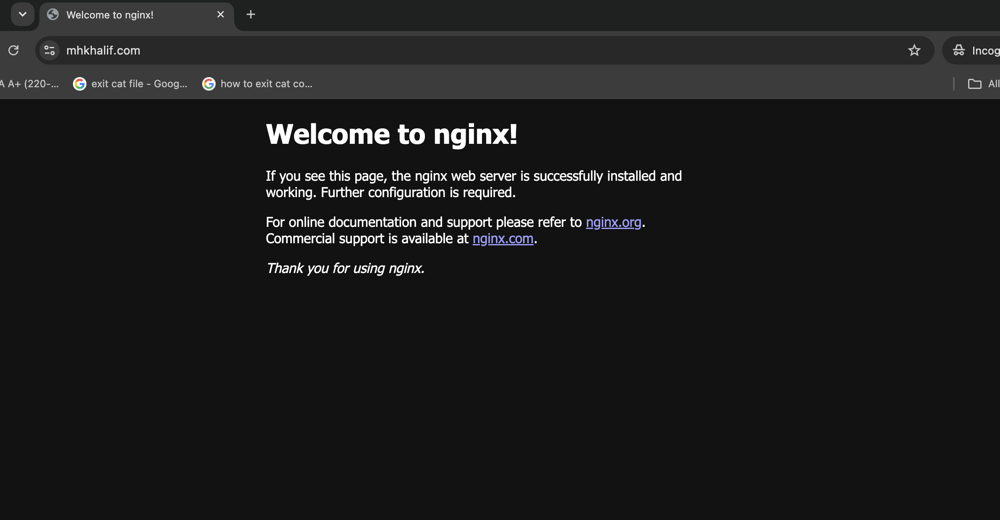
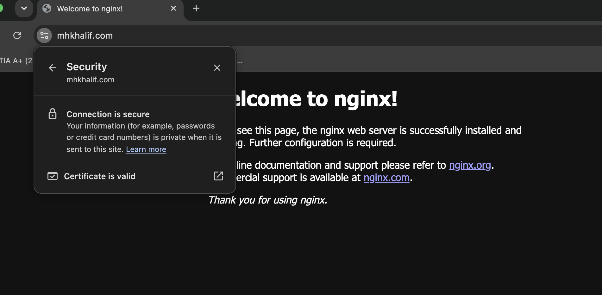

# mhkhalif.com — Nginx on AWS EC2 with a Cloudflare domain

A simple setup that serves the default Nginx welcome page on my own domain, hosted on an AWS EC2 instance, with DNS managed in Cloudflare and HTTPS from Let's Encrypt.

**Status:** Built and verified end to end (HTTP and HTTPS with a valid certificate), then torn down to avoid ongoing costs (Nov 2026).

## Result

**The Nginx welcome page served on `mhkhalif.com`:**



**HTTPS working with a valid Let's Encrypt certificate:**



## Architecture

```
Browser ──► Cloudflare DNS (mhkhalif.com / www) ──► Elastic IP ──► EC2 (Ubuntu 24.04) ──► Nginx
```

| Component | Choice |
|---|---|
| Cloud | AWS EC2 (eu-north-1, Stockholm) |
| OS | Ubuntu Server 24.04 LTS |
| Instance type | t3.micro |
| Web server | Nginx (default welcome page) |
| Domain registrar and DNS | Cloudflare |
| TLS certificate | Let's Encrypt via Certbot |

---

## 1. Launch the EC2 instance

1. In the EC2 console, go to **Launch instance**.
2. Choose **Ubuntu Server 24.04 LTS** on a **t3.micro**.
3. Create and download a key pair (`.pem`).
4. Launch.

## 2. Allocate an Elastic IP

The default public IP changes when the instance stops, which would break DNS.

1. Go to **EC2 → Elastic IPs → Allocate Elastic IP address**.
2. Choose **Actions → Associate**, then select the instance.

> AWS charges a small hourly fee for any public IPv4 address.

## 3. Security group rules

Set these in **Instance → Security tab → Security group → Edit inbound rules**.

### Inbound

| Type | Port | Source | Purpose |
|---|---|---|---|
| SSH | 22 | **My IP** (`x.x.x.x/32`) | Admin access from my machine only |
| HTTP | 80 | `0.0.0.0/0` | Website and Let's Encrypt validation |
| HTTPS | 443 | `0.0.0.0/0` | Secure website |

### Outbound

Left at the default (**All traffic → 0.0.0.0/0**). The server needs it for `apt`, Certbot and DNS. Security groups are stateful, so replies to inbound traffic are allowed automatically.

## 4. Connect over SSH (macOS)

```bash
cd ~/Downloads
chmod 400 mykey.pem
ssh -i mykey.pem ubuntu@<ELASTIC_IP>
```

## 5. Install Nginx

```bash
sudo apt update && sudo apt install nginx -y
```

Nginx starts automatically. Check it:

```bash
sudo systemctl status nginx   # active (running)
curl -I http://localhost      # HTTP/1.1 200 OK
```

## 6. Point the domain at the server (Cloudflare)

Go to **Cloudflare → DNS → Records** and add:

| Type | Name | IPv4 | Proxy status |
|---|---|---|---|
| A | `@` | `<ELASTIC_IP>` | DNS only (grey cloud) |
| A | `www` | `<ELASTIC_IP>` | DNS only (grey cloud) |

Check it:

```bash
dig mhkhalif.com +short
dig www.mhkhalif.com +short
```

Both should return the Elastic IP. `http://mhkhalif.com` should then show the Nginx welcome page.

## 7. Enable HTTPS with Let's Encrypt

```bash
# Replace Nginx's catch-all server name with the real domain so Certbot can find the right server block
sudo sed -i 's/server_name _;/server_name mhkhalif.com www.mhkhalif.com;/' /etc/nginx/sites-available/default

# Test the config, and reload only if it's valid (no downtime)
sudo nginx -t && sudo systemctl reload nginx

# Install Certbot and its Nginx plugin
sudo apt install certbot python3-certbot-nginx -y

# Get a certificate for both names and let Certbot update the Nginx config
sudo certbot --nginx -d mhkhalif.com -d www.mhkhalif.com
```

What Certbot does:
- Proves domain ownership through an HTTP challenge on port 80
- Stores the certificate in `/etc/letsencrypt/`
- Adds `listen 443 ssl` and the certificate paths to the Nginx config
- Optionally redirects HTTP to HTTPS
- Installs a timer that renews the certificate automatically (certificates last 90 days)

Test renewal:

```bash
sudo certbot renew --dry-run
```

## 8. (Optional) Turn on the Cloudflare proxy

Only after HTTPS works on the server:

1. Switch both DNS records to **Proxied (orange cloud)**.
2. Set **SSL/TLS → Overview → Full (strict)**.

This hides the EC2 IP and adds CDN caching and DDoS protection.

---

## Troubleshooting log

### 1. Browser couldn't reach the server, but SSH worked

**Symptoms:** SSH from Terminal was fine. `curl -I http://localhost` on the server returned `200 OK`. The browser timed out on `http://<ELASTIC_IP>`.

**Diagnosis:** Nginx was working locally, so something outside the server was blocking it.

**Cause:** The security group had **no inbound HTTP (80) rule**.

**Fix:** Added inbound rules for **HTTP 80** and **HTTPS 443** from `0.0.0.0/0`.

### 2. SSH was open to the whole internet

**Found:** The default SSH rule allowed port 22 from `0.0.0.0/0`.

**Fix:** Changed the source to **My IP** (`/32`).

**Notes:**
- Ubuntu on EC2 uses key-only authentication, so the exposure risk was low. Bots scanning port 22 can't log in without the `.pem`.
- Checked for unexpected logins:
  ```bash
  sudo grep "Accepted" /var/log/auth.log
  last -a | head
  ```
- If my home IP changes, SSH times out. Fix it by editing the rule and choosing **My IP** again.
- The browser-based **EC2 Instance Connect** no longer works with this restriction, because it connects from AWS IP ranges.

### 3. Cloudflare error page: "Browser ✓ — Cloudflare ✓ — Host ✗"

**Cause:** The DNS records were **Proxied (orange cloud)**. Cloudflare tried to reach the origin over HTTPS, but the server had no certificate yet (Cloudflare errors 521, 522 and 525).

**Fix:** Set the records to **DNS only (grey cloud)** until Certbot is done. Then turn the proxy back on with SSL mode **Full (strict)**.

### 4. Root domain worked, `www` didn't

**Diagnosis:**
```bash
dig mhkhalif.com +short       # returned the Elastic IP, so correct
dig www.mhkhalif.com +short   # checked separately
```

**Cause:** The `www` record was missing, wrong or still proxied.

**Fix:** Made `www` an **A** record pointing to the Elastic IP with **DNS only**.

**Tips:**
- If `dig` returns `104.x.x.x` or `172.67.x.x`, the record is still going through Cloudflare's proxy.
- Flush the DNS cache on macOS:
  ```bash
  sudo dscacheutil -flushcache; sudo killall -HUP mDNSResponder
  ```
- Test in a private browser window, and type `http://` in full until HTTPS is set up.

---

## Quick troubleshooting checklist

| Symptom | Check |
|---|---|
| SSH hangs | Port 22 rule set to your **current** IP |
| SSH "Permission denied (publickey)" | Username `ubuntu`, correct `.pem`, `chmod 400` |
| Browser times out on the IP | Port 80 inbound rule; `curl -I http://localhost` on the server |
| Cloudflare 521, 522 or 525 | Grey-cloud the records, or fix origin HTTPS and use Full (strict) |
| Domain doesn't resolve | `dig <domain> +short` returns the Elastic IP |
| Certbot fails | DNS points at the server, port 80 is open, records are DNS only |

## Teardown

To avoid ongoing charges once the project was verified:

1. **Terminated** the EC2 instance.
2. **Released** the Elastic IP.
3. **Deleted the Cloudflare A records** (`@` and `www`). This matters: a record left pointing at a released IP is a *dangling DNS* risk, because AWS can reassign that IP to another customer, who could then serve content on my domain.
4. **Checked EC2 → Volumes and Snapshots** in eu-north-1: nothing left behind.
5. **Kept the domain** registered in Cloudflare for future use.

To rebuild, follow the steps from section 1. A new Elastic IP will be issued, so update the Cloudflare A records with it.

## Lessons learned

- If a service works on `localhost` but not from outside, check the network path (security groups, firewalls) before the application.
- Default security group rules can leave SSH open to the world, so lock it to your IP from the start.
- Get HTTPS working on the origin *before* enabling the Cloudflare proxy, then use **Full (strict)**.
- Test each DNS name (`@` and `www`) separately with `dig`.
- Clean up DNS when you destroy infrastructure, not just the compute.

## Security notes

- SSH is restricted to my IP; there is no password authentication.
- The `.pem` key is never committed to this repo.
- Set an AWS Budgets billing alarm.
